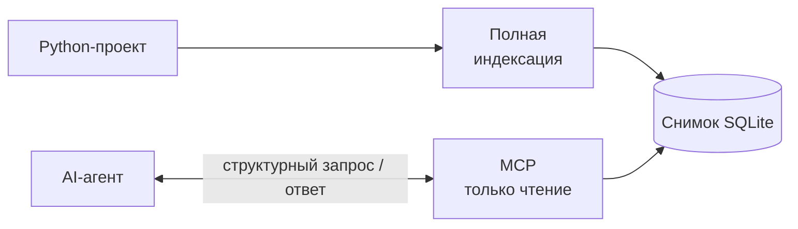
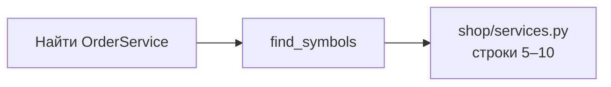
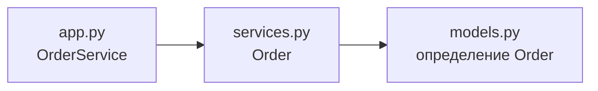
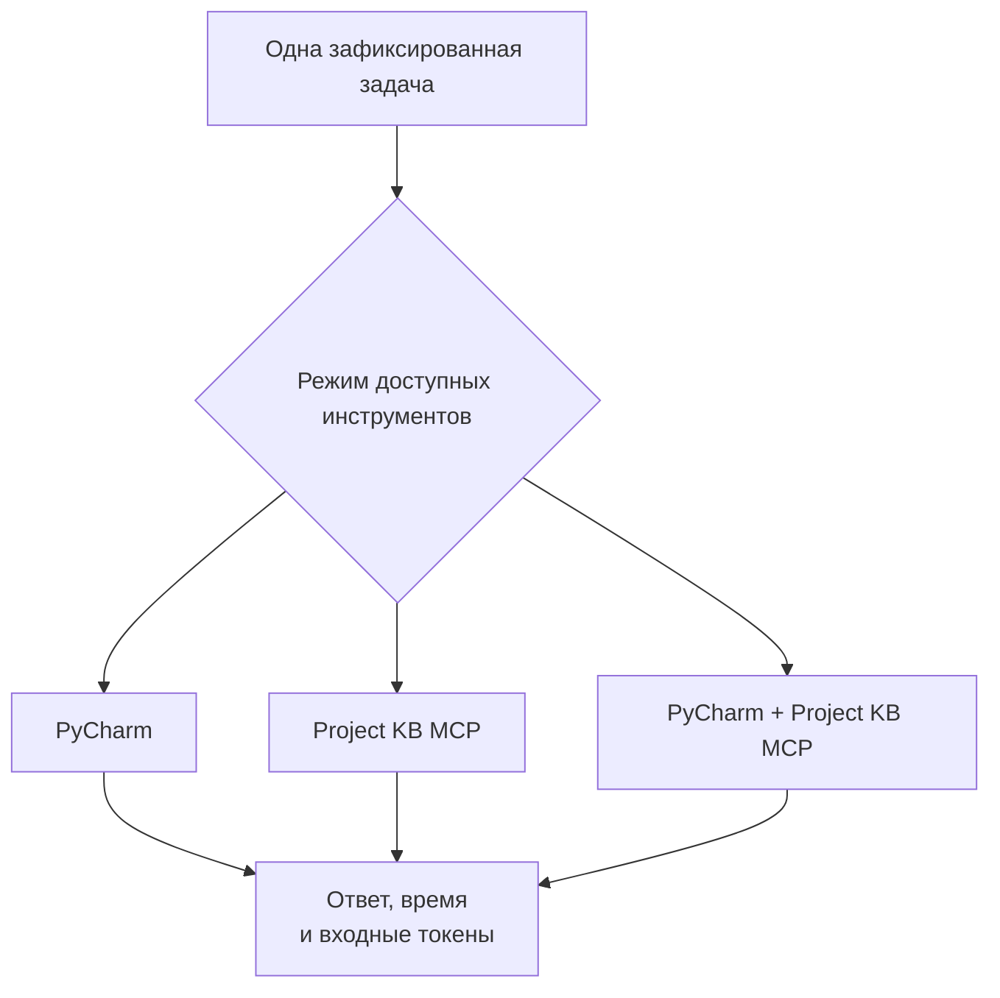

# Project KB — показ проекта

**Как дать AI-агенту структурную карту Python-проекта и связать ответы с конкретным снимком исходников.**

[README](README.md) · [Демонстрационный проект](examples/order_demo/) · [Запустить примеры](#запустить-примеры)

- [Задача](#задача)
- [Как получает данные агент](#как-получает-данные-агент)
- [Чем отличается от поиска и PyCharm MCP](#чем-отличается-от-поиска-и-pycharm-mcp)
- [Примеры на мини-проекте](#примеры-на-мини-проекте)
- [Эксперимент](#эксперимент)
- [Результат проекта](#результат-проекта)

## Задача

Агенту поручают изменить код. Прежде чем действовать, он ищет определения, проверяет импорты и выбирает участки для чтения. Повторный сбор этих сведений расходует контекст; изменение файлов между обращениями требует заново учитывать состояние проекта.

Идея Project KB — заранее получить структурный снимок и предоставить к нему небольшие, проверяемые запросы. Агент может узнать, **где находится определение, какие сущности есть в файле и откуда пришли эти сведения**, а затем обратиться к нужным исходникам.

Это гипотеза об удобстве подготовки контекста. Она не означает, что снимок ускоряет любую задачу или содержит весь смысл программы.

## Как получает данные агент



1. Через CLI регистрируется Git-проект и строится полный снимок.
2. Оператор закрепляет для MCP конкретный файл снимка, его идентичность, SHA-256 и исходный коммит.
3. Агент получает определения, импорты, сведения о файлах и другие разрешённые записи. Можно выбрать поля, ограничить выдачу или выполнить подсчёт.
4. Актуальность относительно рабочей копии проверяет отдельная команда `status --verify strong`.

Python-код целевого проекта читается и разбирается как текст; Project KB его не импортирует и не выполняет. Внутренние компоненты и публикация описаны в [архитектуре](docs/ARCHITECTURE.md).

## Чем отличается от поиска и PyCharm MCP

MCP — общий способ подключения инструментов к агенту. PyCharm уже предоставляет поиск символов, сведения об определениях, иерархию вызовов и рефакторинг.

| Аспект | Поиск по файлам | PyCharm MCP | Project KB |
| --- | --- | --- | --- |
| Основной вопрос | Где имя файла или совпадение текста? | Где символ, как он связан с кодом, какое действие IDE применить? | Какие структурные записи есть в выбранном снимке? |
| Основа ответа | Файлы и найденные строки | Модель проекта в IDE | Один закреплённый SQLite-снимок |
| Представление | Совпадения и фрагменты | Результаты инструментов IDE | Записи с выбранными полями; доступны фильтры, подсчёт, группировка и пакетные запросы |
| Связь с состоянием проекта | Зависит от выбранного поиска и файлов | Контекст проекта IDE | Идентичность и происхождение снимка; отдельная строгая проверка актуальности |
| Применение | Навигация и чтение | Анализ и действия в IDE | Ограниченное структурное чтение для агента |

**Особенность Project KB — контракт чтения сохранённого снимка.** Это позволяет обращаться к одной и той же версии структурных данных независимо от последующих изменений рабочей копии. Цена такого выбора — необходимость построения нового снимка и отдельного контроля актуальности.

Ограничения выдачи есть и у инструментов IDE. Структурные связи Project KB не заменяют полноценный семантический анализ и иерархию вызовов PyCharm. [Возможности PyCharm MCP](https://www.jetbrains.com/help/pycharm/mcp-server.html).

## Примеры на мини-проекте

В репозитории находится [маленький магазин](examples/order_demo/): четыре Python-файла, модель заказа `Order` и класс операций `OrderService`. Они предназначены для демонстрации запросов; реальные заказы и внешние сервисы не используются.

```text
shop/
├── __init__.py
├── app.py          # создаёт заказ через OrderService
├── models.py       # данные Order
└── services.py     # создание и описание заказа
```

Ниже — результаты настоящего запуска CLI и stdio MCP на этих файлах. В таблицах выбраны значимые поля; [переносимая сводка результатов](docs/assets/order-demo-result.json) позволяет проверить значения.

### 1. Найти класс

**Задача агента:** найти код, который создаёт заказ.



| Найденный класс | Файл | Строки |
| --- | --- | --- |
| `OrderService` | [shop/services.py](examples/order_demo/shop/services.py#L5-L10) | 5–10 |
| `Order` | [shop/models.py](examples/order_demo/shop/models.py#L6-L11) | 6–11 |

Агент получает точное место определения и может выбрать участок исходника для чтения.

<details>
<summary>MCP-запрос поиска классов</summary>

```json
{
  "names": ["Order", "OrderService"],
  "match": "exact",
  "symbol_kinds": ["CLASS"],
  "projection": ["relative_path", "short_name", "symbol_kind", "start_line", "end_line"]
}
```

Инструмент: `find_symbols`. Результат также содержит идентичность закреплённого снимка.

</details>

### 2. Разобраться в импорте

**Задача агента:** понять, откуда `OrderService` получает модель заказа.

В [shop/services.py](examples/order_demo/shop/services.py#L2) есть строка `from shop.models import Order`.



| Поле результата | Значение |
| --- | --- |
| Файл | `shop/services.py` |
| Импортируемый модуль | `shop.models` |
| Имя | `Order` |
| Разрешение | `EXACT` |
| Найденный файл | `shop/models.py` |

CLI-запрос в подготовленном демо: `pkb imports order-demo --file shop/services.py`. Через MCP сведения доступны в `inspect_paths` и наборе `imports` инструмента `query_structural_records`.

Стрелки показывают проверенные импорты демонстрационных файлов, а не динамический граф выполнения.

### 3. Получить карту файлов и карточку модуля

**Задача агента:** выбрать файлы для следующего чтения, не запрашивая их содержимое целиком.

MCP `query_structural_records` с `dataset="files"` возвращает список файлов. Из этих записей построено дерево примера выше; отдельной команды `pkb tree` нет.

| Файл | Строк | Разбор Python |
| --- | ---: | --- |
| `shop/__init__.py` | 1 | `SUCCESS` |
| `shop/app.py` | 12 | `SUCCESS` |
| `shop/models.py` | 11 | `SUCCESS` |
| `shop/services.py` | 10 | `SUCCESS` |

Для `shop/services.py` карточка `inspect` дополнительно показывает:

| Сущность | Строки |
| --- | --- |
| Класс `OrderService` | 5–10 |
| Метод `create` | 6–7 |
| Метод `describe` | 9–10 |

Найден один импорт и нет диагностик разбора. MCP `inspect_paths` получает карточки нескольких файлов за один вызов.

### 4. Обнаружить устаревший снимок

**Задача агента:** различать сохранённые сведения и текущее состояние исходников.


| Проверка | Результат демонстрации |
| --- | --- |
| До изменения `shop/models.py` | `CURRENT` |
| После добавления нового класса | `STALE`, изменён `shop/models.py` |
| Чтение того же закреплённого снимка | Успешно |
| Поиск `ExpressOrder` в старом снимке | Класс отсутствует |

Снимок остаётся доступным и неизменяемым, но больше не описывает текущее рабочее дерево. Сам MCP этого различия не устраняет и новую индексацию не запускает.

### Запустить примеры

Нужны Python ≥3.14, uv и Git. Из корня Project KB:

```text
uv sync
uv run python examples/order_demo/run_demo.py
```

Сценарий создаёт отдельный Git-проект и хранилище в пользовательском TEMP. Изменение класса выполняется только в этой временной копии. Обычный запуск удаляет созданные им временные файлы; `--keep-temp` сохраняет их для просмотра, `--json` выводит структурированную сводку.

Можно открыть [исходники магазина](examples/order_demo/shop/) в одном окне, а результат CLI — в другом. [Устройство и команды демонстрации](examples/order_demo/README.md).

## Эксперимент

### Что сравнивали

Проверялся рабочий процесс агента при разных доступных инструментах. Для каждой пары задача × режим выполнялись три независимых запуска: **2 задачи × 3 режима × 3 повтора = 18 запусков**.



Во всех трёх режимах сохранялось встроенное чтение исходников и Git. Инструменты были **разрешены, но не обязательны**. Каждый запуск получал свежую сессию Codex без ответов предыдущих повторов; исходный коммит и снимок были закреплены.

В опубликованной совокупности задачи обозначены `AUDIT_1V2` и `AUDIT_4V2`. Полные исходные постановки и ожидаемые ответы в публичный набор не входят. Ниже сохранены исходные идентификаторы и опубликованные медианы; отсутствие постановок ограничивает содержательную интерпретацию различий между задачами.

### Время выполнения


На `AUDIT_1V2` медиана режима Project KB MCP ниже PyCharm на **29,45%**. На `AUDIT_4V2` разница составляет **−5,24%** для Project KB MCP и **+5,29%** для совместного режима.

### Входные токены


На `AUDIT_1V2` медиана Project KB MCP ниже на **42,33%**. На `AUDIT_4V2` оба сравниваемых режима потребовали примерно **в 2,4 раза больше** входных токенов.

### Что можно заключить

- Результат зависит от задачи: единого победителя эти измерения не дают.
- На первой задаче MCP фактически использовался только в двух из шести запусков режимов Project KB/совместного доступа. Разницу нельзя целиком приписать Project KB.
- Три повтора дают описательные медианы; статистическая значимость не установлена.
- Сравнение качества ответов ограничено историческим дефектом оценщика. Поздняя диагностика не заменяет исходные оценки; одинаковое качество не доказано.
- Графики не объединяют G2 с другими поколениями эксперимента или отдельным квалификационным стендом.

[Данные графиков](docs/assets/g2-metrics.csv) · [Методология](docs/BENCHMARK.md) · [Результаты и исправления](docs/EXPERIMENTS_AND_RESULTS.md). [Скрипт построения графиков](scripts/render_presentation_charts.py) использует опубликованные значения и не запускает новые эксперименты.

## Результат проекта

Реализован узкий инструмент для агента: полная структурная индексация, отдельная проверка актуальности и ограниченное чтение закреплённого снимка через MCP. На простом примере можно увидеть путь от исходника до определения класса, импорта, карты файлов и обнаружения устаревания.

Эксперимент дал смешанный результат и ограничения для дальнейших выводов. Проект сохранён как завершённый структурный прототип; универсальное преимущество по скорости, стоимости или качеству не заявляется.

Обобщённый/семантический поиск, инкрементальная индексация, экспорт и пакеты контекста не реализованы в текущем публичном объёме. Подробности: [архитектура](docs/ARCHITECTURE.md) и [политика безопасности данных](docs/DATA_SAFETY_POLICY.md).
