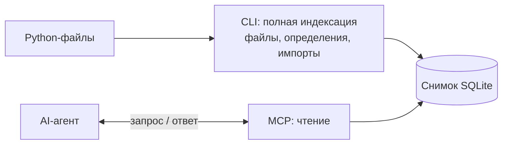
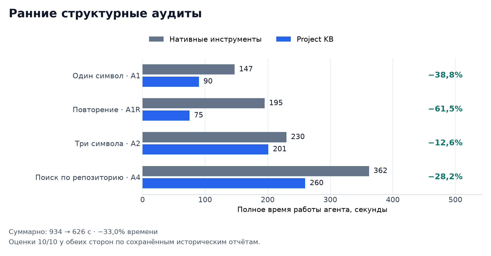
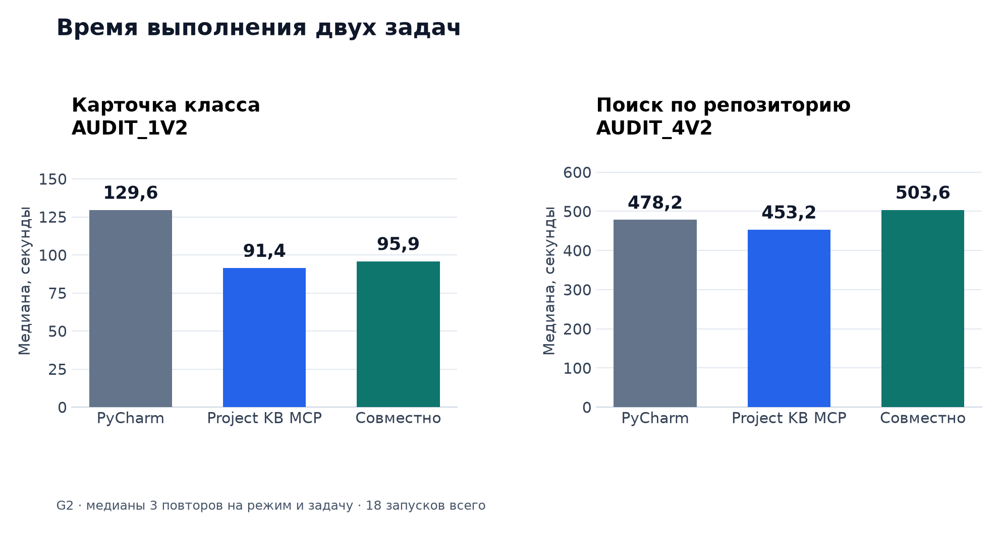
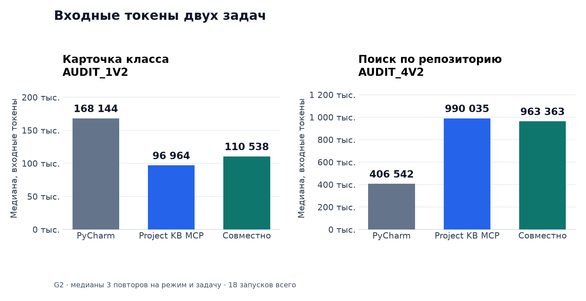

# Project KB — показ проекта

**Как дать AI-агенту структурную карту Python-проекта и сохранить промежуточные состояния его структуры.**

[README](README.md) · [Демонстрационный проект](examples/order_demo/) · [Эксперименты](#эксперимент)

- [Задача](#задача)
- [Чем отличается от поиска и PyCharm MCP](#чем-отличается-от-поиска-и-pycharm-mcp)
- [Как получает данные агент](#как-получает-данные-агент)
- [Примеры на мини-проекте](#примеры-на-мини-проекте)
- [Промежуточные снимки задачи](#промежуточные-снимки-задачи)
- [Эксперимент](#эксперимент)
- [Результат проекта](#результат-проекта)

## Задача

Перед изменением кода агент ищет определения, разбирается в импортах и выбирает файлы для чтения. Повторный сбор этих сведений расходует контекст. После новых правок важно понимать, к какому состоянию проекта относятся уже полученные ответы.

Project KB заранее собирает структуру Python-проекта. Агент может узнать **где находится класс, какие определения есть в файле и куда ведут его импорты**, а затем прочитать нужный участок исходника. Каждый ответ относится к конкретному снимку.

<details>
<summary>Справка CLI: команды и пояснения на русском</summary>


Команда запускается как `uv run pkb <команда>`. Например, `uv run pkb inspect --help` показывает её параметры.

| Команда | Когда нужна | Что получаем |
| --- | --- | --- |
| `version` | Узнать версию программы | Номер установленной версии |
| `capabilities` | Посмотреть доступные возможности | Что реализовано в текущей версии |
| `register` | Подключить локальный Git-проект | Регистрацию проекта по имени и пути |
| `projects` | Найти подключённый проект | Список зарегистрированных проектов |
| `index --full` | Собрать структурную карту | Полный снимок файлов, определений и импортов |
| `status` | Проверить состояние проекта | Состояние регистрации и снимка; с `--verify strong` — его актуальность |
| `symbols` | Найти класс, функцию или метод | Имя, файл и строки определения |
| `imports` | Разобраться в зависимостях файла | Импорты и найденные пути к модулям |
| `inspect` | Посмотреть структуру одного файла | Определения, импорты и ошибки разбора |
| `relink` | Обновить путь после перемещения проекта | Привязку к новому расположению |
| `unregister` | Убрать проект из Project KB | Удаление регистрации и его хранилища Project KB; исходники сохраняются |

</details>

## Чем отличается от поиска и PyCharm MCP

| Что нужно агенту | Поиск по файлам | PyCharm MCP | Project KB |
| --- | --- | --- | --- |
| Найти класс | Найти совпадения имени и выбрать определение | Найти символ средствами IDE | Найти запись класса в подготовленном снимке |
| Узнать содержимое модуля | Прочитать файл и выделить нужное | Запросить сведения инструментами IDE | Получить определения и импорты с выбранными полями |
| Понять, к какому состоянию относятся сведения | Учитывать состояние прочитанных файлов | Учитывать состояние проекта в IDE | Получить идентичность снимка и отдельно проверить его актуальность |
| Снова обратиться к прежней структуре | Прочитать нужную версию файлов | Работать с моделью проекта IDE | Повторно прочитать тот же закреплённый снимок |
| Анализировать поведение и менять код | Читать исходники и применять инструменты разработки | Использовать семантическую навигацию и действия IDE | Использовать структурную карту для выбора исходников |

**Особенность Project KB — сохранённая структурная карта с проверяемым происхождением.** PyCharm предоставляет более глубокий семантический анализ и рефакторинг; Project KB дополняет эти инструменты чтением конкретного снимка. [Возможности PyCharm MCP](https://www.jetbrains.com/help/pycharm/mcp-server.html).

## Как получает данные агент



| Шаг | Что происходит | Результат |
| --- | --- | --- |
| 1. Подключить проект | CLI регистрирует Git-репозиторий | Проект доступен по имени |
| 2. Построить карту | Индексатор читает файлы и разбирает Python как текст | Список файлов, определения, сигнатуры и импорты |
| 3. Подключить агента | Оператор закрепляет конкретный снимок для MCP | Все запросы читают один и тот же артефакт |
| 4. Проверить актуальность | `status --verify strong` сравнивает сведения с рабочей копией | Понятно, соответствует ли снимок исходникам |

Код целевого проекта при индексации не импортируется и не выполняется. Хранилище Project KB отделено от исходников.

<details>
<summary>Какие команды выполняются при подготовке примера</summary>

Сценарий [run_demo.py](examples/order_demo/run_demo.py) создаёт отдельный временный Git-проект, затем выполняет эту последовательность:

```text
pkb register order-demo <путь-к-временному-проекту>
pkb index order-demo --full
pkb status order-demo --verify strong
```

| Операция | Сохранённый результат |
| --- | --- |
| Регистрация | `PROJECT_REGISTERED` |
| Индексация | `INDEX_PUBLISHED` |
| Строгая проверка | `CURRENT` — снимок соответствует исходникам в момент проверки |

Для собственного проекта команды вызываются через `uv run pkb` из установленного Project KB. Демо само подготавливает пути и отдельное хранилище.

</details>

## Примеры на мини-проекте

[Маленький магазин](examples/order_demo/) содержит **4 Python-файла, 34 строки**, модель заказа `Order` и класс операций `OrderService`.

```text
shop/
├── __init__.py
├── app.py          # точка входа: создаёт заказ через OrderService
├── models.py       # данные заказа Order
└── services.py     # создание и описание заказа
```

Ниже — выбранные поля результатов настоящего запуска CLI и MCP. [Сохранённые ответы и запросы](docs/assets/order-demo-result.json).

---

### 1. Найти класс

**Вопрос:** где находится код создания заказа?


| Что найдено | Файл | Строки |
| --- | --- | --- |
| Класс операций `OrderService` | [shop/services.py](examples/order_demo/shop/services.py#L5-L10) | 5–10 |
| Модель заказа `Order` | [shop/models.py](examples/order_demo/shop/models.py#L6-L11) | 6–11 |

**Что узнал агент:** точные места определений двух классов.

<details>
<summary>Команда CLI, MCP-запрос и поля ответа</summary>

CLI для одного класса:

```text
pkb symbols order-demo --name OrderService
```

MCP `find_symbols` для двух классов:

```json
{
  "names": ["Order", "OrderService"],
  "match": "exact",
  "symbol_kinds": ["CLASS"],
  "projection": ["relative_path", "short_name", "symbol_kind", "start_line", "end_line"]
}
```

Выбранные поля ответа:

```json
[
  {"relative_path": "shop/models.py", "short_name": "Order", "start_line": 6, "end_line": 11},
  {"relative_path": "shop/services.py", "short_name": "OrderService", "start_line": 5, "end_line": 10}
]
```

Полный ответ также связывает результат с идентичностью снимка.

</details>

---

### 2. Разобраться в импорте

**Вопрос:** откуда класс операций получает модель заказа?

В [shop/services.py](examples/order_demo/shop/services.py#L2) есть `from shop.models import Order`.


| Сведения об импорте | Результат |
| --- | --- |
| Файл, который импортирует | `shop/services.py` |
| Импортируемое имя | `Order` из `shop.models` |
| Найденное определение модуля | `shop/models.py` |
| Статус `EXACT` | Импорт однозначно разрешён в файл проекта |

**Что узнал агент:** зависимость ведёт к конкретному локальному модулю. Стрелки показывают импорты, а не порядок выполнения программы.

<details>
<summary>Команда и выбранные поля ответа</summary>

```text
pkb imports order-demo --file shop/services.py
```

```json
{
  "module_text": "shop.models",
  "imported_name": "Order",
  "resolution_status": "EXACT",
  "resolved_relative_path": "shop/models.py"
}
```

В MCP те же сведения доступны через `inspect_paths` и набор `imports` инструмента `query_structural_records`.

</details>

---

### 3. Получить карту файлов и карточку модуля

**Вопрос:** из чего состоит проект и какой файл читать дальше?

| Файл | Строк | Проверка синтаксиса Python |
| --- | ---: | --- |
| `shop/__init__.py` | 1 | Успешно |
| `shop/app.py` | 12 | Успешно |
| `shop/models.py` | 11 | Успешно |
| `shop/services.py` | 10 | Успешно |

**«Успешно» (`SUCCESS`)** означает, что файл удалось разобрать и извлечь его структуру. Поведение программы при этом не проверяется.

Карточка `shop/services.py` уточняет содержимое:

| Определение | Строки |
| --- | --- |
| Класс `OrderService` | 5–10 |
| Метод `create` | 6–7 |
| Метод `describe` | 9–10 |

Один импорт, ошибок разбора нет. **Агент получил список файлов и карту определений без запроса полного содержимого каждого модуля.**

<details>
<summary>Как получено дерево и как запросить карточку файла</summary>

Список файлов получен через MCP `query_structural_records`:

```json
{
  "dataset": "files",
  "projection": ["relative_path", "line_count", "parse_status"]
}
```

Из поля `relative_path` этих четырёх записей оформлено дерево в начале примера. Отдельной команды `pkb tree` нет.

Карточка одного файла через CLI:

```text
pkb inspect order-demo --file shop/services.py
```

MCP `inspect_paths` запрашивает несколько файлов за один вызов:

```json
{
  "paths": ["shop/models.py", "shop/services.py"],
  "include": ["file", "symbols", "imports", "diagnostics"]
}
```

</details>

---

### 4. Обнаружить устаревший снимок

**Вопрос:** можно ли считать прежнюю карту описанием уже изменённого проекта?


| Проверка | Результат |
| --- | --- |
| До изменения файла | `CURRENT` — снимок соответствует рабочей копии |
| После добавления класса | `STALE` — изменён `shop/models.py` |
| Поиск `ExpressOrder` в прежнем снимке | Класс отсутствует |

**Что узнал агент:** сохранённые данные доступны, но для нового состояния нужно построить новый снимок.

<details>
<summary>Команда проверки и сведения сохранённого запуска</summary>

До и после изменения выполняется:

```text
pkb status order-demo --verify strong
```

В [сводке демо](docs/assets/order-demo-result.json) сохранены значения:

```json
{
  "currentness_before": "CURRENT",
  "currentness_after": "STALE",
  "changed_paths": ["shop/models.py"],
  "same_pinned_snapshot": true,
  "old_snapshot_still_readable": true,
  "new_class_in_old_snapshot": false
}
```

MCP продолжает читать тот же снимок и сам не запускает индексацию.

</details>

---

### Запустить примеры

Нужны Python ≥3.14, uv и Git. Из корня Project KB:

```text
uv sync
uv run python examples/order_demo/run_demo.py
```

Сценарий работает в отдельном временном проекте. `--keep-temp` сохраняет его для просмотра, `--json` выводит переносимую сводку. Можно открыть исходники магазина в одном окне, результат — в другом. [Устройство демонстрации](examples/order_demo/README.md).

## Промежуточные снимки задачи

**Внутренний экспериментальный механизм.** В рамках одной задачи сохраняются исходная структура проекта и связанные рабочие поколения после промежуточных правок.


| Что даёт агенту | Как устроено |
| --- | --- |
| Контрольные точки между коммитами | Working-снимки допускают незакоммиченные правки |
| Обращение к прежнему шагу | У снимка есть своя идентичность; рабочие поколения связаны с предыдущими |
| Поиск области изменений | Сравнение показывает добавленные, удалённые и изменённые структурные записи |
| Отдельное хранение | Поколения не меняют исходники и историю Git |

Создаётся полная структурная карта; сравнение можно ограничить путями или модулями. Это не резервная копия исходного кода. Управление поколениями реализовано внутренним API, в публичные CLI/MCP не выведено; практическая польза в длительной работе агента глубоко не исследована. [Подробности реализации](docs/ARCHITECTURE.md#54-внутренние-поколения-жизненного-цикла).

## Эксперимент

Исследование началось с парных структурных аудитов, затем перешло к сравнению четырёх режимов и повторным запускам через MCP.

### 1. Ранние структурные аудиты

Сравнивались агент с нативными инструментами и агент с Project KB.



**934 → 626 секунд, −33% суммарного времени.** В каждой из четырёх пар обе стороны получили 10/10 по сохранённым историческим отчётам. A1R — повторение первого аудита; остальные пары относятся к разным задачам. [Числа и происхождение](docs/EXPERIMENTS_AND_RESULTS.md#ранние-структурные-аудиты).

### 2. E4A: четыре режима доступа до MCP Project KB

Объект — зафиксированная версия проекта атрибуции. Каждая задача выполнена один раз в каждом режиме: **3 × 4 = 12 запусков, все ответы — 10/10**.

| Задача | Что нужно восстановить | Масштаб |
| --- | --- | --- |
| `AUDIT_1V2` | Карточку `WorkflowStateRepository`: определение, сигнатуры, импорты | 1 класс, 3 публичных метода |
| `AUDIT_2` | Три класса и их зависимости | 3 класса, 10 публичных методов |
| `AUDIT_4V2` | Поисковую матрицу по всему репозиторию | 129 файлов, 7 классов репозиториев, 36 публичных async-методов |

Native — исходники и Git. PyCharm и Project KB добавляют соответствующий инструмент; совместный режим разрешает оба. Время в секундах:

| Задача | Native | PyCharm | Project KB | Совместно |
| --- | ---: | ---: | ---: | ---: |
| Карточка класса | 211,67 | 268,77 | 167,35 | 208,29 |
| Три класса | 337,87 | 299,05 | 344,65 | 320,09 |
| Поиск по репозиторию | 696,63 | 544,63 | 849,04 | 531,80 |

Совместный режим быстрее Native на всех трёх задачах. На карточке класса PKB потребовал на **37,7% меньше времени**, чем PyCharm; на большом поиске чистый PKB оказался медленнее — проявились расходы на постраничную выдачу.

Здесь Project KB читался прямым адаптером, без собственного MCP-транспорта. Во всех режимах сохранялся доступ к исходникам и Git. [Постановки и условия](docs/BENCHMARK.md#задачи-g2-в-публичном-наборе).

### 3. G2: повторные испытания через MCP

Две из тех же задач, три режима, три независимых повтора: **2 × 3 × 3 = 18 запусков**. Каждая сессия начиналась заново; коммит и снимок были закреплены.





| Задача | Project KB MCP относительно PyCharm |
| --- | --- |
| Карточка одного класса | **−29,45% времени, −42,33% входных токенов** |
| Поиск по репозиторию | **−5,24% времени, +143,53% входных токенов** |

Выигрыш зависит от задачи. Инструменты были разрешены, но не обязательны: на первой задаче PKB MCP фактически использовался лишь в 2 из 6 запусков режимов PKB/совместного доступа, поэтому всю разницу нельзя приписать самому инструменту. На оценки качества G2 повлияла ошибка идентификаторов в оценщике; [исходные баллы и отдельная диагностика](docs/EXPERIMENTS_AND_RESULTS.md#6-исправление-оценщика-и-диагностика-только-по-отображению-идентификаторов) показаны рядом.

<details>
<summary>Другие направления исследования</summary>

| Направление | Что выяснили |
| --- | --- |
| Июльские CLI-пилоты | Проверка актуальности и повторное чтение могут съесть выигрыш индекса; выявлены пробелы покрытия |
| Семантический Hybrid | Отдельный опыт дал 262 → 157 с со специально подготовленным оператором |
| Изменение кода: B1–B3 | Преимущество меняло направление; прохождение тестов не гарантировало полной семантической корректности |
| Межслойный аудит W-Lite | Обе стороны нашли 9/9 дефектов; Native оказался быстрее |
| Проверки состояний | Исследовались актуальность и восстановление; длительный рабочий процесс агента глубоко не проверен |

[Полная компактная история испытаний](docs/EXPERIMENTS_AND_RESULTS.md).

</details>

[Ранние данные](docs/assets/early-structural-metrics.csv) · [Данные E4A](docs/assets/e4a-metrics.csv) · [Медианы G2](docs/assets/g2-metrics.csv) · [Методология](docs/BENCHMARK.md)

Графики построены из сохранённых результатов; новые эксперименты для презентации не проводились.

## Результат проекта

Создан структурный инструмент для агента: индексация Python-проекта, проверка актуальности, чтение закреплённого снимка через MCP и внутренний механизм промежуточных поколений.

Ранние аудиты показали практический выигрыш в подготовке структурного контекста. Более широкие испытания выявили границы пользы и расходы интерфейса. **Дальнейшая разработка заморожена из-за ограниченного времени и ресурсов; реализация и результаты исследования сохранены.**

Семантический поиск, инкрементальная индексация, экспорт и пакеты контекста в текущий публичный объём не входят. [Архитектура](docs/ARCHITECTURE.md) · [Политика безопасности данных](docs/DATA_SAFETY_POLICY.md).
