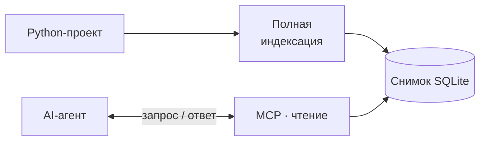
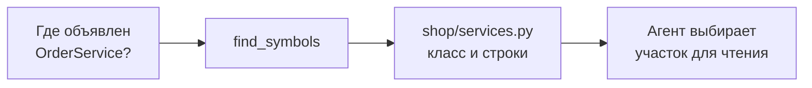
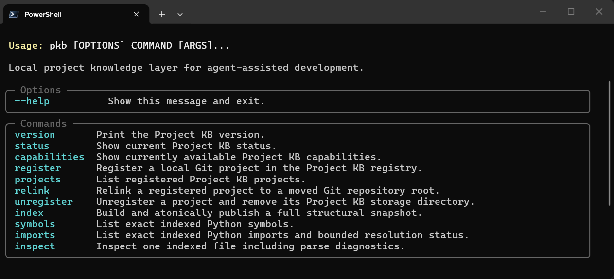

<div align="center">

# Project KB

**Структурная карта Python-проектов для AI-агентов: снимки SQLite, проверка актуальности и запросы через MCP.**


[Показ проекта](PRESENTATION.md) · [Простой пример](examples/order_demo/) · [Быстрый старт](#быстрый-старт)

</div>

## Зачем нужен Project KB

При работе с кодовой базой агент ищет определения, собирает импорты и выбирает файлы для чтения. Эти сведения приходится связывать с конкретным состоянием проекта: доступный результат может уже не соответствовать изменённым исходникам.

Project KB строит структурный снимок Python-проекта и предоставляет запросы к нему: найти класс, получить сведения о файле, выбрать записи с нужными полями или посчитать их. Ответы MCP связаны с одним закреплённым снимком; отдельная строгая проверка определяет его актуальность относительно рабочей копии.

Целевой Python-код не импортируется и не выполняется. Полная индексация и хранение отделены от исходников.

**Содержание**

- [Как работает](#как-работает)
- [Возможности](#возможности)
- [Живой пример](#живой-пример)
- [Быстрый старт](#быстрый-старт)
- [Эксперименты](#эксперименты)
- [Ограничения](#ограничения)
- [Документация](#документация)

## Как работает



Оператор подготавливает снимок через CLI. MCP читает явно выбранный артефакт и возвращает структурные данные с его идентичностью. Проверка `status --verify strong` выполняется отдельно: закреплённость снимка не означает, что исходники с тех пор не изменились.

PyCharm MCP также умеет искать символы и анализировать связи. Особенность Project KB — контракт чтения сохранённого снимка с проверяемым происхождением данных. [Сравнение подходов и полная схема показа](PRESENTATION.md#чем-отличается-от-поиска-и-pycharm-mcp).

## Возможности

| Задача | Интерфейс |
| --- | --- |
| Зарегистрировать проект и построить полный снимок | `register`, `index --full` |
| Проверить состояние и актуальность | `status --verify strong` |
| Найти определение класса или функции | `symbols`, MCP `find_symbols` |
| Получить импорты и карточку файла | `imports`, `inspect`, MCP `inspect_paths` |
| Выбрать файлы и структурные записи, посчитать или сгруппировать их | MCP `query_structural_records` |
| Получить идентичность и происхождение снимка | MCP `get_snapshot_metadata` |

MCP поддерживает выбор полей, ограничения числа записей и размера ответа, постраничное чтение и пакетные запросы.

## Живой пример

В [мини-проекте магазина](examples/order_demo/) есть заказ `Order`, класс `OrderService` и точка входа. На нём можно пройти цепочку от исходного файла до ответа агенту:



[Презентация](PRESENTATION.md#примеры-на-мини-проекте) показывает исходники, реальные результаты запросов, дерево файлов и обнаружение устаревшего снимка.

## Быстрый старт

Нужны **Python ≥3.14**, **uv** и **Git**. Из корня репозитория:

```text
uv sync
uv run pkb --help
```

<details>
<summary>Справка CLI</summary>



</details>

Воспроизводимый пример с отдельным временным Git-проектом и хранилищем:

```text
uv run python examples/order_demo/run_demo.py
```

Сценарий выполняет регистрацию, индексацию, строгую проверку, запросы CLI и MCP, затем демонстрирует устаревание снимка. Для просмотра созданных файлов используйте `--keep-temp`; для структурированного результата — `--json`. [Команды и устройство примера](examples/order_demo/README.md).

Для собственного Git-проекта:

```text
uv run pkb register my-project /path/to/repository
uv run pkb index my-project --full
uv run pkb status my-project --verify strong
uv run pkb symbols my-project --name OrderService
```

Для запуска отдельного MCP-процесса передаются путь снимка, его идентичность, SHA-256 и исходный коммит. [Настройка и границы MCP](docs/ARCHITECTURE.md#55-закреплённое-оператором-чтение-через-mcp).

## Эксперименты

В сравнении трёх режимов доступа агента на двух задачах выполнено 18 запусков. Результаты смешанные: на одной задаче снизились медианы времени и входных токенов; на другой существенного выигрыша времени не было, а входных токенов потребовалось примерно в 2,4 раза больше.

Это наблюдение режимов доступных инструментов, а не доказанное универсальное ускорение от Project KB. [Постановка сравнения, графики и ограничения](PRESENTATION.md#эксперимент).

## Ограничения

- Поддерживается полная структурная индексация Python/Git-проектов; инкрементальная индексация не реализована.
- Обобщённый и семантический поиск, экспорт и пакеты контекста отключены.
- MCP работает только на чтение закреплённого снимка и не выбирает автоматически последний.
- Читаемый снимок может быть устаревшим; `CURRENT` относится к моменту успешной строгой проверки.
- Структурные данные дополняют чтение исходников и анализ IDE; они не заменяют полноценную семантическую модель PyCharm.

Версия `0.1.0` — завершённый структурный прототип.

## Документация

| Документ | Содержание |
| --- | --- |
| [Архитектура](docs/ARCHITECTURE.md) | Компоненты, жизненный цикл снимка и границы ответственности |
| [Политика безопасности данных](docs/DATA_SAFETY_POLICY.md) | Исходники, пути, хранилище и проверки |
| [Методология эксперимента](docs/BENCHMARK.md) | Задачи, режимы доступа, изоляция и правила измерения |
| [Эксперименты и результаты](docs/EXPERIMENTS_AND_RESULTS.md) | Медианы, качество ответов и границы выводов |

<details>
<summary>Для разработки</summary>

- [Контрольный список разработки](docs/DEVELOPMENT_CHECKLIST.md)
- [История разработки](docs/DEVELOPMENT_HISTORY.md)

</details>
